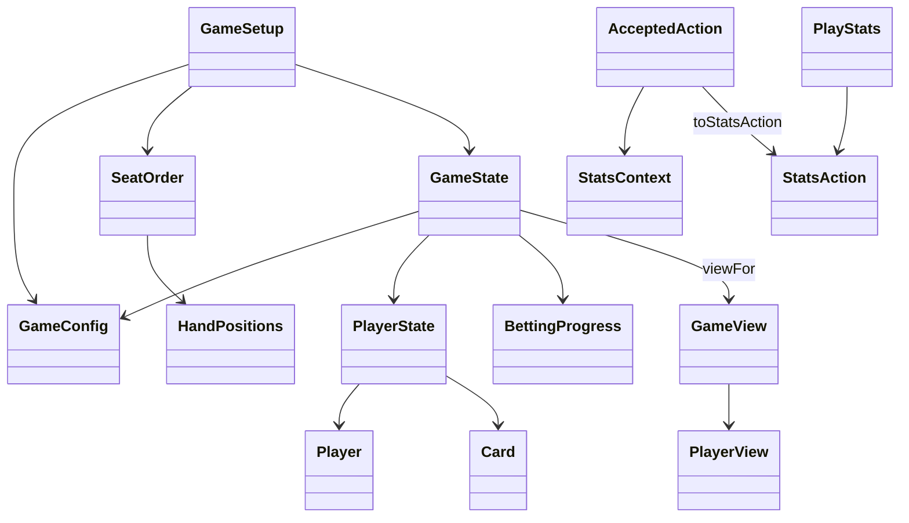

# System design

The [foundation contract](shared-contract.md) defines settings, stable seats, immutable
hand state, action messages and filtered player views. Game rules, bot decisions and
the interface remain separate components.

Member A supplies deck creation, shuffling, dealing and hand evaluation using the shared
card values. The engine accepts `ActionRequest`, validates it against current state,
then produces a new snapshot and `AcceptedAction`. Bots and the interface receive
`GameView`; profiles and saved statistics stay separate from live match state.

Implemented here: initialization and immutable contracts. Betting execution, street
advancement, pot settlement, bot strategy, profile storage, interface and CI follow later.
