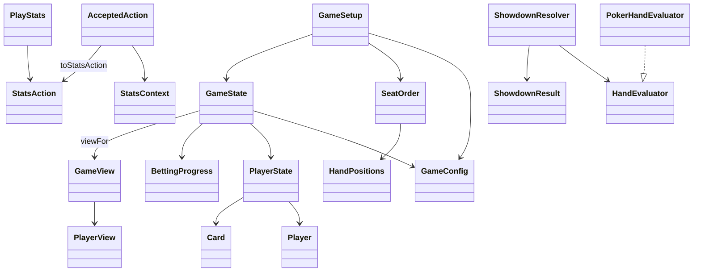

# System design

The [foundation contract](shared-contract.md) defines settings, stable seats, immutable
hand state, action messages and filtered player views. Game rules, bot decisions and
the interface remain separate components.

Member A supplies the shared `domain.model.Card`, rank/suit enums, deck creation,
shuffling and dealing primitives. The existing HandEvaluator interface now has one PokerHandEvaluator implementation,
used by ShowdownResolver to return immutable results awaiting settlement. See
[showdown design](showdown.md). The future betting engine will accept `ActionRequest`, validate it against current state,
then produce a new snapshot and `AcceptedAction`. Bots and the interface receive
`GameView`; profiles and saved statistics stay separate from live match state.

Implemented here: initialization, immutable contracts, best-five comparison and
closed-state winner/tie resolution without payouts. Betting execution, street
advancement, pot settlement, bot strategy and profile storage follow later.
The Swing setup preview uses SetupSession and
SetupView to display initialization and private-card handoffs; see [setup design](game-setup.md).
CI builds and tests pushes and pull requests.

[Localization](localization.md) covers English/Chinese discovery, selection and
private-card handoffs. [Quality checks](../quality.md) document Checkstyle,
SpotBugs, scoped coverage and mutation results.
