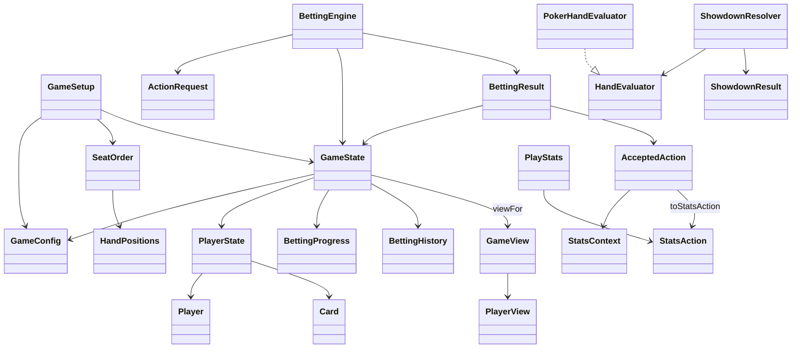

# System design

The [foundation contract](shared-contract.md) defines settings, stable seats, immutable
hand state, action messages and filtered player views. Game rules, bot decisions and
the interface remain separate components.

Member A supplies the shared `domain.model.Card`, rank/suit enums, deck creation,
shuffling and dealing primitives. The existing HandEvaluator interface now has one PokerHandEvaluator implementation,
used by ShowdownResolver to return immutable results awaiting settlement. See
[showdown design](showdown.md). The betting engine accepts `ActionRequest`,
validates it against current state, then produces a new snapshot and
`AcceptedAction`. Bots and the interface receive
`GameView`; profiles and saved statistics stay separate from live match state.

Implemented here: initialization, immutable contracts and full
FOLD/CHECK/CALL/BET/RAISE on every street, including short all-ins and
individual/cumulative reopening. Legal-action information comes from the engine.
`BettingEngine.apply` returns a `BettingResult`
with a new state and accepted action; it does not mutate earlier snapshots or
update statistics itself. Pending active players act clockwise, retaining the
big blind's option. Folded, all-in and eliminated seats do not act; all-in seats
still count as participants. When no decisions remain, the actor is absent and
the pot/phase/cards are retained for a separate advancement or settlement step.
Calls add at most the caller's available stack. Stack exhaustion sets ALL_IN
and `becameAllIn=true`, while the accepted action stays CALL. Short calls retain
the current bet, last full raise size and other players' pending decisions.
`BettingEngine.advanceStreet` explicitly advances a closed round through
FLOP/TURN/RIVER/SHOWDOWN. It rejects pending or unpaid ACTIVE decisions and hands
with fewer than two participants. It burns one card before each community-card
street, deals in order and resets round accounting while preserving hand
commitments. New decisions require at least two ACTIVE players; an all-in runout
can advance without player actions. SHOWDOWN retains the completed river's
accounting and leaves all pots unawarded.
Postflop accepted actions report FLOP/TURN/RIVER rather than PREFLOP. The
immutable `BettingHistory` records the final preflop aggressor and an actual
flop continuation bet's original target. The engine uses that provenance,
amount owed, current betting level and legal betting rights to emit opportunity
context; `PlayStats` does not reconstruct the betting tree. The original
GameState constructor creates empty history, while the explicit-history
constructor validates it and engine operations preserve it across snapshots.
Two integration demonstrations connect real setup/dealing, preflop actions,
postflop checks/folds and advancement through SHOWDOWN without paying pots.
Settlement, completed statistics and match continuation are available, with
full betting/legal options and departure handling integrated from PR #23.
Varied bot policies and safe worker integration remain E05/E06; profiles are
developed separately and still need integration. See the
[engine BVA](../bva/BettingEngine.md).
ShowdownResolver supplies winner/tie comparisons; PotSettlement separately
pays awardable pots and refunds. SetupSession now connects the played betting flow to ShowdownResolver and Swing;
see [played-hand application flow](played-hand.md).
The Swing setup preview uses SetupSession and
SetupView to display initialization and private-card handoffs; see [setup design](game-setup.md).
CI builds and tests pushes and pull requests.

[Localization](localization.md) covers English/Chinese discovery, selection and
private-card handoffs. [Quality checks](../quality.md) document Checkstyle,
SpotBugs, scoped coverage and mutation results.

## Method design

Each new or changed method should do one named task. Keep orchestration readable
by extracting independent validation, dealing, state transitions and rendering
steps into private helpers. Keep constructors short and collaborators injectable
where coordination needs isolated tests. Use non-null caller contracts and explicit
absence; retain business validation and external resource/data validation. Splitting a
method should improve its responsibilities, not merely move lines elsewhere.
Apply these method-design rules to future changes.

## Standalone equity (E03)

`EquityRequest.fromView` copies only the viewer's two cards, the public board and
ordered ACTIVE/ALL_IN participant IDs. Folded/eliminated seats are excluded.
`EquityPot` describes an awardable public scenario: amount, identity and eligible
players. The engine/application must supply this eligibility and remove uncalled
refunds. E03 does not reconstruct settlement layers or action legality. Scenarios
may describe a prospective legal call rather than the currently displayed pot.

`UniformDealSampler` builds a fresh unseen 52-card universe from rank/suit values,
removes known cards, then samples remaining board cards and two cards per live
opponent without replacement. All live opponents are sampled, including those
ineligible for a particular pot. This preserves card blocking across pots.
The sampled board is shared by all seven-card holdings. Hidden folded cards and
unobserved burns are marginalized under this uniform model; actual hidden cards
and physical deck order are never accessed. Uniform hands are a baseline design
choice, not learned ranges or a GTO claim.

`MonteCarloEquityEstimator` reuses `PokerHandEvaluator`. Each trial compares the
hero with each opponent once; each pot then uses only its eligible contenders.
A win contributes 1, a loss 0 and a tie with k eligible opponents 1/(k+1).
The returned map contains mean shares, including 0 for hero-ineligible pots.
Expected payout is the amount-weighted sum of these shares. Equity divides this
expectation by the total hero-eligible awardable amount. Neither value includes
refunds, future betting, integer odd-chip allocation or net profit; action EV
requires calling costs and later strategy. Values stay numeric and unrounded.

The ports `HandEvaluator`, `DealSampler` and `EquityEstimator` permit isolated
unit tests. Integration tests separately cover real comparisons, a six-way royal
flush, exact enumeration of all 990 heads-up river hands, and hidden-data
invariance. Fixed seeds reproduce results; they do not establish a general error
bound. Error and observational latency are recorded in standard JUnit output.

Requests are immutable, have checked chip totals and bound trials to 1–10,000.
That initial cap limits work, not wall-clock latency. Cancellation or interruption
is checked between trials and throws without returning a partial result; retries
start fresh totals. RNG-backed estimator instances belong to one worker. E06 must
run them off Swing's event thread, attach match/hand/state identity and discard
stale results before submitting actions. E04 adds smoothed opponent beliefs; E05 chooses varied legal actions using
the shared engine contract.
None of those later integrations is completed by this calculator.

## Opponent learning (E04)

Each bot owns a match-scoped `OpponentModel`, registered with its own participant
ID and up to five opponent IDs. On a serialized owner thread, the application
passes **committed** `AcceptedAction` events wrapped in `PublicDecision`, with
match identity and a positive sequence increasing across all hands. Events may
skip numbers; they must arrive in engine order. No ActionRequest or rejected
StatsAction is accepted by this API. Learning happens only after application
publication succeeds, so a failed engine/statistics transaction cannot train it.

A voluntary decision includes `DecisionContext`: public street, actual available
choices and whether the player acts in position. The engine/application supplies
that pre-action snapshot; the model does not reconstruct turn or betting rules.
Raise eligibility and three-bet classification remain separate. A three-bet flag
requires a legal RAISE; a c-bet opportunity requires a legal BET. Short/all-in
choices keep their resolved CALL/BET/RAISE meaning. Metadata does not include
opponents' hole cards, the physical deck, hidden equity or profile passwords.

Forced posts and departure folds have no strategic preference meaning and may
omit decision context entirely. The explicit origin distinguishes a voluntary
fold from quit-as-fold, including a non-current departure with no legal turn
choices. Already-all-in departure behavior still belongs to Kevin's K04 contract;
this model neither folds an all-in player nor invents a decision. Own actions,
forced posts and automatic departures advance the event sequence but do not
change beliefs. Replayed/stale sequences are ignored. A wrong match or unknown
participant is rejected before publication. A failed updater publishes neither
new beliefs nor the sequence, so the same event can be retried once.

`OpponentBeliefs` contains immutable predictions and tendency estimates, with
mutable registries confined to the model owner. Snapshot readers never mutate
counters. Contexts match by street, legal-choice set and position, keeping a
bounded collection of at most 248 contexts per opponent (4 streets × 2 position
states × 31 nonempty subsets of five choices). Queries for unseen contexts create
a prior result without storing new evidence. There is no per-event history or
unfinished-match persistence; creating a new match creates a new model. Profile
lifetime statistics and exact PlayStats reporting remain independent.

For K available actions, `ActionPrediction` uses a Dirichlet prior with one
pseudo-count per choice. After N decisions, action a has posterior predictive
probability (count[a]+1)/(N+K). It reports raw counts, posterior marginal standard
deviations sqrt(p[a]×(1−p[a])/(N+K+1)) and evidence weight N/(N+K). Illegal choices
have no entry. With only one available choice, prediction is deterministically
one with zero uncertainty, independent of strategic skill.

`TendencyEstimate` tracks decision-level three-bets, flop c-bets and folds to
actual flop c-bets. It consumes explicit engine opportunity flags, including
calls/folds/checks that decline an eligible action. With S successes in N
opportunities, the Beta(1,1) posterior mean is (S+1)/(N+2), standard deviation
sqrt(p×(1−p)/(N+3)), and evidence weight N/(N+2). Four-bets are not three-bets;
ordinary flop bets/folds do not create c-bet opportunities. These decision-level
beliefs are not the completed-hand percentage definitions in PlayStats.

Zero observations mean a prior, **not a measured 50% rate**. Evidence weight is
data weight relative to the prior, not a confidence interval or a claim that the
model is correct. Uncertainty assumes exchangeable observations within each
coarse context. Sparse contexts, selection effects and changing opponents limit
that assumption. Counts are cumulative; new evidence changes beliefs gradually,
without forgetting older play. A future recency model needs its own validation.

The small contextual probability model is our project design. Research on
[Bayesian poker opponent modeling](https://poker.cs.ualberta.ca/publications/UAI05.pdf)
motivates separating uncertain opponent strategy from game dynamics; this is
not a reproduction of that paper's full model or a GTO claim. The prior formulas
follow [Beta-binomial updating](https://stat210a.berkeley.edu/fall-2025/reader/bayes-estimation.html)
and [Dirichlet distributions](https://mc-stan.org/docs/2_31/functions-reference/dirichlet-distribution.html).
An action-frequency model does not identify hidden-card likelihoods. E03's hand
sampling remains uniform; weighted hand-range inference requires a separately
specified and validated likelihood model.

Unit tests isolate context matching, posterior arithmetic and coordinator
failure/retry behavior. Real-component integrations cover rejected versus
accepted engine actions, observer/opponent isolation, match reset and departure
exclusion. Controlled held-out evaluation compares learned and disabled-learning
multiclass Brier error (sum of squared action-probability errors; lower is better).
Four permutations of fixed train/held-out compositions test order invariance;
they are not four independent playing-strength measurements. E05/E06 still need
to use these snapshots in varied legal decisions, wire committed engine events,
run simulations off Swing's event thread and reject stale calculated actions.

## Instructor follow-up (November 15)

The cleanup is applied to the local integration of merged PR #23 with E03/E04.
BettingEngine.advanceStreet is a short coordinator. Dealing a street, validating
available cards, choosing pending actors, selecting the first actor and forming
the board have focused helper names. requireClosedRound delegates separately to
pending-decision, participation and matched-contribution checks.

Required application-owned reference arguments follow a non-null caller contract.
Internal actor selection and stored preflop aggression use Optional. GameState.create
requires an Optional actor; nullable String actor constructors were removed. All
production callers and existing fixtures use the same explicit API. BettingHistory
accepts an Optional for absence, or a required String for a known aggressor.
PublicDecision has a separate automatic-event overload without strategic context.
There are no manual equality checks against null in production. The localization
loader normalizes the JDK's potentially missing resource once with Optional;
missing/malformed external resources still fail with a meaningful error.

Manual null guards and Objects.requireNonNull calls have been removed throughout
production, including constructors and collaborator-result handling. Required
collaborators follow the same non-null caller contract as other internal inputs.
Business validation still rejects blank/unknown identities, duplicate cards,
invalid amounts, illegal actions and inconsistent lifecycle transitions.
Seat indexing uses an immutable ordered list and explicit membership sets;
owned registries validate membership before reading required values.

GameConfig.SEAT_COUNT is shared by player/position bounds, clockwise payout,
seat selection, the table UI and bot capacities. Defaults for starting chips and
blinds are named. checkstyleSeatRules initially applies MagicNumber to GameConfig,
HandPositions, SeatOrder, Player and PotSettlement. It runs through check/build;
this is a declared initial scope, not a claim of global magic-number enforcement.

Production Checkstyle also rejects an empty line immediately before an outer
type's closing brace. The negative check caught StatisticsPanel line 85 and the
same problem in InitialDeal before their fixes. Another targeted production rule
rejects manual null comparisons, returning an absence sentinel, unwrapping
Optional into one, starting constructor delegation with one, or adding
requireNonNull/isNull/nonNull guard calls. These checks
prevent the observed patterns; they do not replace type design or thorough review.

The five retained new TDD/BVA cases cover present/absent actors, preserved
history, an unknown actor and inconsistent pending decisions. The new cases
contain no programmer-error reference inputs. Existing integration tests verify
full betting, short all-ins, payouts and statistics after the refactor.

For E05/E06, use the authoritative LegalActions and Wager.allows APIs. A nominal
full minimum may be unaffordable: a supplied shortAllInTarget is the exact legal
alternative. Live learning still needs committed event identity/order, explicit
departure origin and pre-action public context; equity needs engine-owned public
pot scenarios and a filtered bot view.

## Varied decision policy (E05)

E05 is a pure backend policy in bot.policy. It does not start workers or change
SetupSession.playBotTurns; E06 owns live event wiring, cancellation and stale-state
rejection. BotPolicy has no mutable fields or random source. It returns an
immutable ActionDistribution; the caller supplies a random quantile in [0,1).

PolicyRequest accepts a filtered GameView, the matching authoritative LegalActions,
a public CallValue and immutable OpponentBeliefs snapshots. It checks the acting
bot, basic option/cost/stack correspondence and scenario bounds. Those checks do
not prove provenance: E06 must bind view, options, estimate and match/hand/revision
to the same captured state. No private opponent cards or physical deck enter the
policy. Existing Player and profile identities need no policy-specific fields.

### Call valuation and public information

The application supplies equity e and the amount P of awardable pots the hero
can win after calling. P excludes ineligible side pots and uncalled refunds.
CallValue separately records the guaranteed refund R of newly called chips only;
it must not credit a refund of an earlier commitment against the new call cost.
With engine gross calling cost C, newly risked chips are C-R and break-even
equity is q=(C-R)/P. The zero-pot, zero-cost case is an empty OptionalDouble;
the policy uses zero required equity only because no new chips are at risk.
Side-pot construction and refund determination remain application/engine work,
rather than duplicated betting/settlement rules inside the policy.

For E03 results, use the estimate's equity and the request's eligible pot amount
from the same prospective-call scenario. This is showdown value under the supplied
simulation model, not a complete action EV including future bets and folds.
E03 still samples uniform opponent hands; E05 does not claim learned hand ranges.

### Preferences and probability distributions

Position means last among active responders in this street's public seat order:
after the big blind preflop, after the dealer postflop. Folded, eliminated,
departed and all-in seats do not affect response position. All-in contenders do
remain in the equity calculation and participant count N.

OpponentBeliefs.getAggressionEstimate(street) derives a Beta(1,1) estimate from
accepted public decisions on that street where BET or RAISE was available.
Bets/raises are successes; declining by checking/calling/folding is a failure.
Forced/departure/replayed events were already filtered by E04. Other streets and
decisions without an aggressive choice provide no such opportunity. This is
decision-level belief, separate from completed-hand PlayStats percentages.

For each active opponent, pressure is (posterior probability - .5) multiplied
by its evidence weight. Missing evidence contributes zero. The policy averages
over active opponents; it does not treat the prior as measured aggression.

| Personality | Equity bias b | Aggression multiplier a | Eligible-pot sizing fraction |
| --- | --- | --- | --- |
| CAUTIOUS | -.02 | .8 | .5 |
| BALANCED | 0 | 1 | .75 |
| AGGRESSIVE | +.02 | 1.2 | 1 |

Free CHECK has passive weight 1 and never FOLD. A fully refunded CALL also has
passive weight 1. Paid zero-equity calls fold; certain equity never folds.
Other paid decisions use:

- edge = e-q + b + .01 if in position, minus .06 × pressure and .02 ×
  (new chips at risk / available stack).
- CALL weight = max(0, edge+.05); FOLD weight = max(0, .05-edge).

An aggressive action is considered only when the engine supplies one and e>=q.
Its strength is e-1/N-.08+b, plus .04 in position, minus .06 × pressure.
Its weight is max(0,strength) × .5 × a × (1-.4 × newly added wager chips/stack).
These are explicit project heuristics and calibration parameters. Balanced play
mixes calls and raises, rather than always raising strong hands. The formula is
not a GTO strategy, a proof of profitable play or a requirement to win one test.

### Wager sizing and sampling

For a legal short all-in, use its exact supplied target. Otherwise start from
roundContribution + grossCallCost, add the rounded personality fraction of P
up to available stack room, then enforce the engine's full minimum. Existing
round chips are not deducted again. Sizing never constructs its own minimum-raise
or reopening rules; LegalActions.Wager remains authoritative.

Positive weights are normalized once and copied at the ownership boundary.
Enum order defines half-open sampling intervals; the last action absorbs floating
roundoff. There is no display rounding or hard-coded percentage text. Seeding the
caller's random source makes decisions reproducible while retaining variation.

### Evidence and limits

The initial local RED/GREEN cycles were: missing CallValue/aggression APIs then
14 passing cases; missing PolicyRequest/distribution APIs then 22 passing cases;
12 policy behavior failures against the unsupported implementation, then GREEN.
Integration, coverage and mutation regressions were added afterward, not claimed
as original feature RED cycles. No Git TDD checkpoint commits were fabricated.

Tests cover legal targets on every street, short/full all-ins, side-pot odds,
new-call refunds, confidence-weighted learning, position/stack/personality effects,
fixed-seed sampling frequencies and accounting-offset invariance. Real evaluator,
equity, policy and betting components are exercised together; another flow reaches
settlement after a short-blind refund. Hidden cards and deck order cannot change
seeded decisions. See per-class BVA and the current quality results.

Live bots still use the temporary check/call application policy. E06 must build
authoritative public scenarios, wire committed public events with origin/context,
run simulations off Swing's event thread and reject stale results before action
submission. Profile integration and the documented departure/terminal-policy
follow-ups remain separate.
