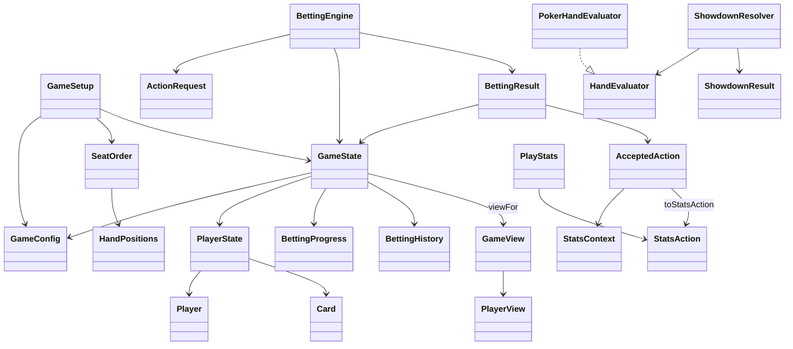

# System design

The [foundation contract](shared-contract.md) defines settings, stable seats, immutable
hand state, action messages and filtered player views. Game rules, bot decisions and
the interface remain separate components.

Member A supplies the shared `domain.model.Card`, rank/suit enums, deck creation,
shuffling and dealing primitives. The existing HandEvaluator interface now has one PokerHandEvaluator implementation,
used by ShowdownResolver to return immutable results awaiting settlement. See
[showdown design](showdown.md). The betting engine accepts `ActionRequest`,
validates it against current state, then produces a new snapshot and
`AcceptedAction`. Bots and the interface receive
`GameView`; profiles and saved statistics stay separate from live match state.

Implemented here: initialization, immutable contracts, unraised preflop
FOLD/CHECK/CALL (including all-in calls), and postflop CHECK/FOLD.
`BettingEngine.apply` returns a `BettingResult`
with a new state and accepted action; it does not mutate earlier snapshots or
update statistics itself. Pending active players act clockwise, retaining the
big blind's option. Folded, all-in and eliminated seats do not act; all-in seats
still count as participants. When no decisions remain, the actor is absent and
the pot/phase/cards are retained for a separate advancement or settlement step.
Calls add at most the caller's available stack. Stack exhaustion sets ALL_IN
and `becameAllIn=true`, while the accepted action stays CALL. Short calls retain
the current bet, last full raise size and other players' pending decisions.
`BettingEngine.advanceStreet` explicitly advances a closed round through
FLOP/TURN/RIVER/SHOWDOWN. It rejects pending or unpaid ACTIVE decisions and hands
with fewer than two participants. It burns one card before each community-card
street, deals in order and resets round accounting while preserving hand
commitments. New decisions require at least two ACTIVE players; an all-in runout
can advance without player actions. SHOWDOWN retains the completed river's
accounting and leaves all pots unawarded.
Postflop accepted actions report FLOP/TURN/RIVER rather than PREFLOP. The
immutable `BettingHistory` records the final preflop aggressor and an actual
flop continuation bet's original target. The engine uses that provenance,
amount owed, current betting level and legal betting rights to emit opportunity
context; `PlayStats` does not reconstruct the betting tree. The original
GameState constructor creates empty history, while the explicit-history
constructor validates it and engine operations preserve it across snapshots.
Two integration demonstrations connect real setup/dealing, preflop actions,
postflop checks/folds and advancement through SHOWDOWN without paying pots.
Betting/raising, raised-round action handling, postflop CALL, pot
settlement, bot strategy and profile storage follow later. See the
[engine BVA](../bva/BettingEngine.md).
Best-five evaluation and closed-state winner/tie resolution are also implemented
without payouts. SetupSession now connects the played betting flow to ShowdownResolver and Swing;
see [played-hand application flow](played-hand.md).
The Swing setup preview uses SetupSession and
SetupView to display initialization and private-card handoffs; see [setup design](game-setup.md).
CI builds and tests pushes and pull requests.

[Localization](localization.md) covers English/Chinese discovery, selection and
private-card handoffs. [Quality checks](../quality.md) document Checkstyle,
SpotBugs, scoped coverage and mutation results.

## Method design

Each new or changed method should do one named task. Keep orchestration readable
by extracting independent validation, dealing, state transitions and rendering
steps into private helpers. Keep constructors short and collaborators injectable
where coordination needs isolated tests. Prefer explicit absence to nullable
internal values, while retaining validation at public boundaries. Splitting a
method should improve its responsibilities, not merely move lines elsewhere.
Apply these method-design rules to future changes.

## Standalone equity (E03)

`EquityRequest.fromView` copies only the viewer's two cards, the public board and
ordered ACTIVE/ALL_IN participant IDs. Folded/eliminated seats are excluded.
`EquityPot` describes an awardable public scenario: amount, identity and eligible
players. The engine/application must supply this eligibility and remove uncalled
refunds. E03 does not reconstruct settlement layers or action legality. Scenarios
may describe a prospective legal call rather than the currently displayed pot.

`UniformDealSampler` builds a fresh unseen 52-card universe from rank/suit values,
removes known cards, then samples remaining board cards and two cards per live
opponent without replacement. All live opponents are sampled, including those
ineligible for a particular pot. This preserves card blocking across pots.
The sampled board is shared by all seven-card holdings. Hidden folded cards and
unobserved burns are marginalized under this uniform model; actual hidden cards
and physical deck order are never accessed. Uniform hands are a baseline design
choice, not learned ranges or a GTO claim.

`MonteCarloEquityEstimator` reuses `PokerHandEvaluator`. Each trial compares the
hero with each opponent once; each pot then uses only its eligible contenders.
A win contributes 1, a loss 0 and a tie with k eligible opponents 1/(k+1).
The returned map contains mean shares, including 0 for hero-ineligible pots.
Expected payout is the amount-weighted sum of these shares. Equity divides this
expectation by the total hero-eligible awardable amount. Neither value includes
refunds, future betting, integer odd-chip allocation or net profit; action EV
requires calling costs and later strategy. Values stay numeric and unrounded.

The ports `HandEvaluator`, `DealSampler` and `EquityEstimator` permit isolated
unit tests. Integration tests separately cover real comparisons, a six-way royal
flush, exact enumeration of all 990 heads-up river hands, and hidden-data
invariance. Fixed seeds reproduce results; they do not establish a general error
bound. Error and observational latency are recorded in standard JUnit output.

Requests are immutable, have checked chip totals and bound trials to 1–10,000.
That initial cap limits work, not wall-clock latency. Cancellation or interruption
is checked between trials and throws without returning a partial result; retries
start fresh totals. RNG-backed estimator instances belong to one worker. E06 must
run them off Swing's event thread, attach match/hand/state identity and discard
stale results before submitting actions. E04 adds smoothed opponent beliefs/range
sampling; E05 chooses varied legal actions using the shared engine contract.
None of those later integrations is completed by this calculator.
