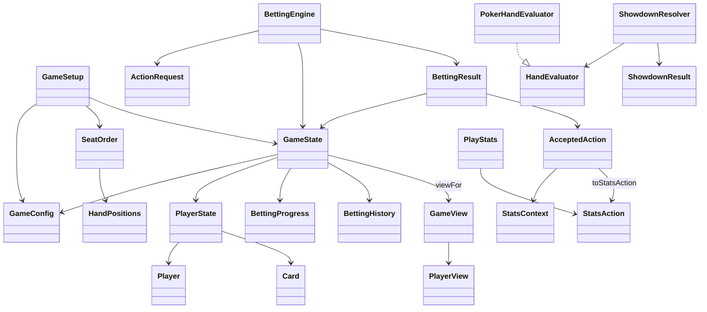

# System design

The [foundation contract](shared-contract.md) defines settings, stable seats, immutable
hand state, action messages and filtered player views. Game rules, bot decisions and
the interface remain separate components.

Member A supplies the shared `domain.model.Card`, rank/suit enums, deck creation,
shuffling and dealing primitives. The existing HandEvaluator interface now has one PokerHandEvaluator implementation,
used by ShowdownResolver to return immutable results awaiting settlement. See
[showdown design](showdown.md). The betting engine accepts `ActionRequest`,
validates it against current state, then produces a new snapshot and
`AcceptedAction`. Bots and the interface receive
`GameView`; profiles and saved statistics stay separate from live match state.

Implemented here: initialization, immutable contracts, unraised preflop
FOLD/CHECK/CALL (including all-in calls), and postflop CHECK/FOLD.
`BettingEngine.apply` returns a `BettingResult`
with a new state and accepted action; it does not mutate earlier snapshots or
update statistics itself. Pending active players act clockwise, retaining the
big blind's option. Folded, all-in and eliminated seats do not act; all-in seats
still count as participants. When no decisions remain, the actor is absent and
the pot/phase/cards are retained for a separate advancement or settlement step.
Calls add at most the caller's available stack. Stack exhaustion sets ALL_IN
and `becameAllIn=true`, while the accepted action stays CALL. Short calls retain
the current bet, last full raise size and other players' pending decisions.
`BettingEngine.advanceStreet` explicitly advances a closed round through
FLOP/TURN/RIVER/SHOWDOWN. It rejects pending or unpaid ACTIVE decisions and hands
with fewer than two participants. It burns one card before each community-card
street, deals in order and resets round accounting while preserving hand
commitments. New decisions require at least two ACTIVE players; an all-in runout
can advance without player actions. SHOWDOWN retains the completed river's
accounting and leaves all pots unawarded.
Postflop accepted actions report FLOP/TURN/RIVER rather than PREFLOP. The
immutable `BettingHistory` records the final preflop aggressor and an actual
flop continuation bet's original target. The engine uses that provenance,
amount owed, current betting level and legal betting rights to emit opportunity
context; `PlayStats` does not reconstruct the betting tree. The original
GameState constructor creates empty history, while the explicit-history
constructor validates it and engine operations preserve it across snapshots.
Two integration demonstrations connect real setup/dealing, preflop actions,
postflop checks/folds and advancement through SHOWDOWN without paying pots.
Betting/raising, raised-round action handling, postflop CALL, pot
settlement and bot strategy were outside that initial checkpoint; later payout
and local-profile increments are described below. See the
[engine BVA](../bva/BettingEngine.md).
Best-five evaluation and closed-state winner/tie resolution are also implemented
without payouts. SetupSession now connects the played betting flow to ShowdownResolver and Swing;
see [played-hand application flow](played-hand.md).
The Swing setup preview uses SetupSession and
SetupView to display initialization and private-card handoffs; see [setup design](game-setup.md).
CI builds and tests pushes and pull requests.

[Localization](localization.md) covers English/Chinese discovery, selection and
private-card handoffs. [Quality checks](../quality.md) document Checkstyle,
SpotBugs, scoped coverage and mutation results.

## Method design

Each new or changed method should do one named task. Keep orchestration readable
by extracting independent validation, dealing, state transitions and rendering
steps into private helpers. Keep constructors short and collaborators injectable
where coordination needs isolated tests. Prefer explicit absence to nullable
internal values, while retaining validation at public boundaries. Splitting a
method should improve its responsibilities, not merely move lines elsewhere.
Apply these method-design rules to future changes.

## Local password accounts

`PlayerProfile` is an immutable stable ID and Unicode display name, separate
from a match Player, seat, stack and unfinished hand. Names may repeat; profile
selection uses the ID. `ProfileService` generates UUID IDs, registers an account
with a password, lists public identities and authenticates the selected ID.
`find`/`list` return selection metadata, never an authenticated session.

The service injects `ProfileRepository`, `PasswordHasher` and an ID supplier for
isolated tests. Its default collaborators use UUIDs and PBKDF2. `StoredProfile`
combines identity, `PasswordHash` and completed lifetime statistics for one
atomic file replacement. No profile
is returned from registration before saving succeeds. Fresh service instances
load from the same directory rather than relying on an in-memory cache.

`FileProfileRepository` stores UTF-8 `profiles.properties` in a caller-supplied
application-data directory. Catalog version 3 stores identity, Base64 salt/hash, raw completed counters
and completed-hand IDs; the version fixes the hashing algorithm/work factor.
Version-2 password accounts load with empty statistics and upgrade on a successful
save; merely loading an old catalog does not rewrite it. The adapter validates the full snapshot,
writes/closes a same-directory temporary file, then requests atomic replacement.
Unsupported replacement or corrupt data produces IOException; it does not reset
saved accounts. Profile IDs are values, never filesystem paths. The application
must serialize writers; multi-process updates are outside this contract.

`Pbkdf2PasswordHasher` uses PBKDF2-HMAC-SHA256, 600,000 iterations, independent
16-byte SecureRandom salts and 32 derived bytes. New passwords contain 6–15 valid
characters; verification retains the former upper bound of 128 for existing
accounts. Passwords are neither trimmed nor normalized. Verification uses
MessageDigest.isEqual; temporary derived bytes and PBEKeySpec copies are cleared.
The desktop clears caller-owned char arrays after account work finishes.
The provider seam supports isolated failure/cleanup tests; independent reference
vectors also verify the real JCA algorithm.

## Completed lifetime statistics

`ProfileService.login(id,password)` returns an `AuthenticatedProfile` handle only
after password verification. A handle is tied to its issuing service and lives
only in memory. `getLifetimeStatistics(handle)` checks ownership and fresh storage
before returning immutable rates. Metadata lookup alone cannot open statistics.

`SetupSession.startProfiles(service,handles)` starts a fresh match with distinct
accounts in human seat order; bots are excluded. `ProfileMatch` keeps the mapping
from match player IDs to persistent profile IDs. The mapping survives nextHand,
while successful unprofiled start clears it. Rejected starts preserve the prior
match and bindings. Profile selection/login screens remain future UI work.

`CompletedStatistics` stores all 16 raw counters and an immutable completed-ID
set. `Statistic` defines stable serialized names. Validation checks nonnegative
counts, hand/opportunity subsets and postflop participation. `PlayStats` exports
committed counters/history even while another hand is active, and restoration
never resumes pending observations. Existing rate formulas and OptionalDouble
unavailable values are reused; percentages are never stored or rounded.

For settlement, MatchStatistics first creates a single-hand delta from accepted
actions and paid outcomes. A new match-total snapshot is prepared separately.
The profile service merges all bound human deltas and saves the complete catalog
once, preserving other accounts and credentials. Only after that save succeeds
does SetupSession publish paid chips, completed match totals and settlement.
IOException is wrapped in UncheckedIOException for the existing settleHand API;
the previous hand remains available for retry. An already persisted hand ID is
an idempotent redelivery and causes no additional write or aggregation.

Hand IDs must remain globally unique across matches. Engine setup/continuation
already generate UUID-based IDs. The first authoritative completed delivery owns
an ID; this backend does not accept frontend-supplied statistical summaries.
A crash after durable save but before in-memory publication cannot duplicate
that completion. No unfinished match, private card, stack or password is saved.

The application serializes profile writers; this is not a multi-process storage
protocol. Completed history currently grows with completed hands to preserve
exact deduplication. Integration tests cover real showdown/restart and real
failed-save/retry flows in JUnit TempDir folders. No real user profile data is
created. See [lifetime BVA](../bva/LifetimeStatistics.md),
[snapshot BVA](../bva/CompletedStatisticsSnapshot.md) and
[storage BVA](../bva/StatisticsProperties.md).

## Desktop profile flow — November 10

Main constructs ProfileService with FileProfileRepository in `user.home/.cs380-holdem`
(or the `cs380.profileDirectory` JVM override) and supplies it to GamePanel. The
repository constructor is lazy; initial catalog loading uses a SwingWorker.
Production Start Game requires 1–6 authenticated profiles. The single-argument
GamePanel constructor remains an unprofiled component-composition fixture for
existing setup/gameplay tests; Main uses the profile-enabled constructor.

ProfilePanel is a Swing view with a private live model, separate registration and
sign-in forms, numbered saved-account choices and an ordered next-match roster.
Registration commits one account, then selects it for sign-in. Only successful
password verification adds a player. Wrong passwords do not reveal lifetime data.
Names and opaque identities remain separate; numbered entries disambiguate same-
name accounts without exposing technical IDs in the normal player flow.

Account creation, authentication, listing and lifetime reads run on SwingWorker
threads. Password arrays are copied from JPasswordField, the fields immediately
cleared, and each captured array zeroed in a finally block after success/failure.
Callbacks update Swing state only on the event thread. A busy guard disables
match mutation while account work runs, preserving the serialized-writer contract.
Settlement continues to use the synchronous backend boundary; UncheckedIOException
is translated into a localized, retryable error instead of escaping the UI.

GamePanel snapshots profile names for the active match, so roster removal affects
only future setup. It does not implement departure/quit-as-fold (K04). Cards stay
hidden on player/tab/language/focus changes. Lifetime rows refresh after settlement
and when a signed-in profile is selected. Both match and lifetime tables remain
read-only; existing OptionalDouble/N/A and AF/percentage formatting are reused.
All new labels/errors use the validated locale resources. User names are escaped
where Swing labels interpret HTML.

The view model holds services, authenticated handles and callbacks and is never
serialized. One exact SE_BAD_FIELD filter for ProfilePanel.model follows the
existing GamePanel live-state exceptions; persisted data remains the explicit
versioned catalog. See [UI BVA](../bva/ProfileScreen.md) and
[quality record](../quality.md#desktop-profile-flow--november-10-2026).

Password-length revision: registration now enforces 6–15 characters. Verification
accepts 6–128 so previously saved longer passwords remain usable. The credential
algorithm/work factor and catalog schema are unchanged; existing accounts are not
rewritten. Character counting/encoding behavior remains unchanged, and the UI hint
uses plain English/Chinese wording without technical terms or range symbols.
