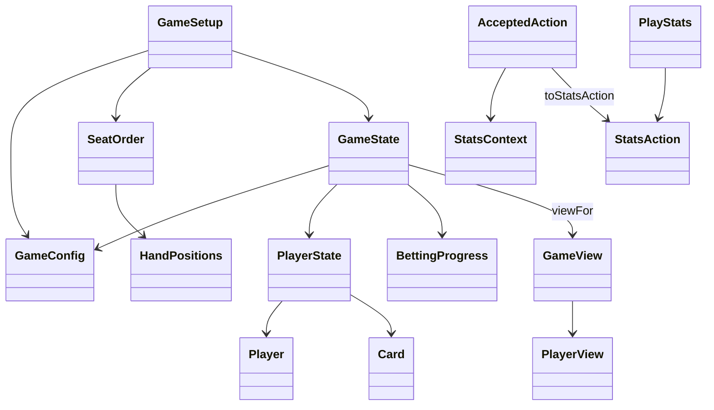

# System design

The [foundation contract](shared-contract.md) defines settings, stable seats, immutable
hand state, action messages and filtered player views. Game rules, bot decisions and
the interface remain separate components.

Member A supplies the shared `domain.model.Card`, rank/suit enums, deck creation,
shuffling and dealing primitives. Hand evaluation remains an interface for later work. The engine accepts `ActionRequest`, validates it against current state,
then produces a new snapshot and `AcceptedAction`. Bots and the interface receive
`GameView`; profiles and saved statistics stay separate from live match state.

Implemented here: initialization and immutable contracts. Betting execution, street
advancement, pot settlement, bot strategy and profile storage follow later.
The Swing setup preview uses SetupSession and
SetupView to display initialization and private-card handoffs; see [setup design](game-setup.md).
CI builds and tests pushes and pull requests.
