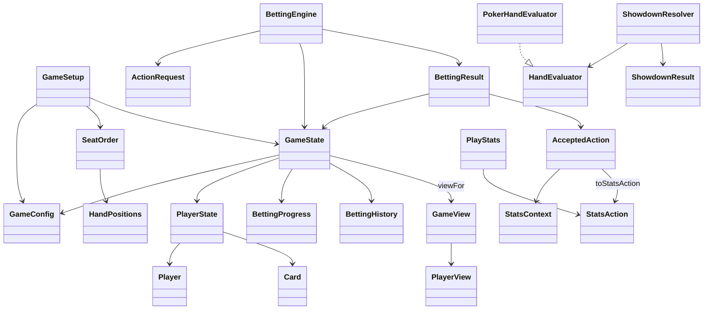

# System design

## Full-chip match victory — November 16

SetupSession.getMatchWinner requires successful settlement and a player holding
the full configured chip total, normally 6,000. The query scans paid ownership
across all fixed seats. An all-in quitter's complete payout and a completed
winner's later departure retain that victory. Starting a new match clears the
paid result and departure state.

The existing retirement contract is retained: departed stacks stay owned and
receive no later cards/blinds. Two or more funded nondeparted seats can continue,
including heads-up dealing and blind order. With zero or one such seat and chips
still split, play stops without a match winner. English/Chinese resources make
that outcome explicit. Completed-hand statistics and chip conservation remain
independent of the absence of a match winner.

## Immediate quit-as-fold — November 16

An active human's quit takes effect immediately through the engine's dedicated
foldDepartingPlayer operation. It preserves another pending actor's turn, removes
the quitter's decision/raise rights and eligibility, and retains cards and chip
ownership. Ordinary submitted actions still require the current actor.

SetupSession prepares automatic public-event successors and the resulting hand
before recording/publishing the fold. A recording failure leaves the departure
and bot revision retryable. BotTable.afterDeparture needs no legal-choice or
position context and excludes the event from strategic learning. All-in players
retain current-hand eligibility. Folded players and resolved hands acquire no
extra fold. The compatibility playDepartureTurns entry point refreshes private
handoffs after quit has already committed the departure.

The earlier queued-fold policy is superseded for I03. The I07 full-total victory
and stopped-match rules are described above; local fixes await review/CI/merge.

## Bot/profile integration — November 16

SetupSession.startMatch prepares a fresh bot table, revision, match statistics and
optional authenticated-profile binding. Both start and startProfiles use it.
Learning survives nextHand within the match and resets on a successful new match.
Settlement prepares the payout and completed delta, saves bound lifetime data,
then publishes paid state, match totals and the next bot revision. Storage failure
preserves the unpaid state for idempotent retry, including a durable-save/response
failure. Profile-bound restart rejects previously captured bot turns.

GamePanel combines profile forms/roster and private handoffs with the bounded
background controller, explicit bot retry and window-close cleanup. Account work
locks manual match controls, including bot retry. Constructor injection lets
presentation tests supply the existing deterministic scheduler. Separate real
component tests combine adaptive equity/policy decisions with profile save,
restart, failure/retry and continuation.

The [foundation contract](shared-contract.md) defines settings, stable seats, immutable
hand state, action messages and filtered player views. Game rules, bot decisions and
the interface remain separate components.

Member A supplies the shared `domain.model.Card`, rank/suit enums, deck creation,
shuffling and dealing primitives. The existing HandEvaluator interface now has one PokerHandEvaluator implementation,
used by ShowdownResolver to return immutable results awaiting settlement. See
[showdown design](showdown.md). The betting engine accepts `ActionRequest`,
validates it against current state, then produces a new snapshot and
`AcceptedAction`. Bots and the interface receive
`GameView`; profiles and saved statistics stay separate from live match state.

Implemented here: initialization, immutable contracts and full
FOLD/CHECK/CALL/BET/RAISE on every street, including short all-ins and
individual/cumulative reopening. Legal-action information comes from the engine.
`BettingEngine.apply` returns a `BettingResult`
with a new state and accepted action; it does not mutate earlier snapshots or
update statistics itself. Pending active players act clockwise, retaining the
big blind's option. Folded, all-in and eliminated seats do not act; all-in seats
still count as participants. When no decisions remain, the actor is absent and
the pot/phase/cards are retained for a separate advancement or settlement step.
Calls add at most the caller's available stack. Stack exhaustion sets ALL_IN
and `becameAllIn=true`, while the accepted action stays CALL. Short calls retain
the current bet, last full raise size and other players' pending decisions.
`BettingEngine.advanceStreet` explicitly advances a closed round through
FLOP/TURN/RIVER/SHOWDOWN. It rejects pending or unpaid ACTIVE decisions and hands
with fewer than two participants. It burns one card before each community-card
street, deals in order and resets round accounting while preserving hand
commitments. New decisions require at least two ACTIVE players; an all-in runout
can advance without player actions. SHOWDOWN retains the completed river's
accounting and leaves all pots unawarded.
Postflop accepted actions report FLOP/TURN/RIVER rather than PREFLOP. The
immutable `BettingHistory` records the final preflop aggressor and an actual
flop continuation bet's original target. The engine uses that provenance,
amount owed, current betting level and legal betting rights to emit opportunity
context; `PlayStats` does not reconstruct the betting tree. The original
GameState constructor creates empty history, while the explicit-history
constructor validates it and engine operations preserve it across snapshots.
Two integration demonstrations connect real setup/dealing, preflop actions,
postflop checks/folds and advancement through SHOWDOWN without paying pots.
Betting/raising, raised-round action handling, postflop CALL, pot
settlement and bot strategy were outside that initial checkpoint; later payout
and local-profile increments are described below. See the
Settlement, completed statistics and match continuation are available, with
full betting/legal options and departure handling integrated from PR #23.
Varied bot policies and safe worker integration are implemented in E05/E06
below; profiles are developed separately and still need integration. See the
[engine BVA](../bva/BettingEngine.md).
ShowdownResolver supplies winner/tie comparisons; PotSettlement separately
pays awardable pots and refunds. SetupSession now connects the played betting flow to ShowdownResolver and Swing;
see [played-hand application flow](played-hand.md).
The Swing setup preview uses SetupSession and
SetupView to display initialization and private-card handoffs; see [setup design](game-setup.md).
CI builds and tests pushes and pull requests.

[Localization](localization.md) covers English/Chinese discovery, selection and
private-card handoffs. [Quality checks](../quality.md) document Checkstyle,
SpotBugs, scoped coverage and mutation results.

## Method design

Each new or changed method should do one named task. Keep orchestration readable
by extracting independent validation, dealing, state transitions and rendering
steps into private helpers. Keep constructors short and collaborators injectable
where coordination needs isolated tests. Use non-null caller contracts and explicit
absence; retain business validation and external resource/data validation. Splitting a
method should improve its responsibilities, not merely move lines elsewhere.
Apply these method-design rules to future changes.

## Local password accounts

`PlayerProfile` is an immutable stable ID and Unicode display name, separate
from a match Player, seat, stack and unfinished hand. Names may repeat; profile
selection uses the ID. `ProfileService` generates UUID IDs, registers an account
with a password, lists public identities and authenticates the selected ID.
`find`/`list` return selection metadata, never an authenticated session.

The service injects `ProfileRepository`, `PasswordHasher` and an ID supplier for
isolated tests. Its default collaborators use UUIDs and PBKDF2. `StoredProfile`
combines identity, `PasswordHash` and completed lifetime statistics for one
atomic file replacement. No profile
is returned from registration before saving succeeds. Fresh service instances
load from the same directory rather than relying on an in-memory cache.

`FileProfileRepository` stores UTF-8 `profiles.properties` in a caller-supplied
application-data directory. Catalog version 3 stores identity, Base64 salt/hash, raw completed counters
and completed-hand IDs; the version fixes the hashing algorithm/work factor.
Version-2 password accounts load with empty statistics and upgrade on a successful
save; merely loading an old catalog does not rewrite it. The adapter validates the full snapshot,
writes/closes a same-directory temporary file, then requests atomic replacement.
Unsupported replacement or corrupt data produces IOException; it does not reset
saved accounts. Profile IDs are values, never filesystem paths. The application
must serialize writers; multi-process updates are outside this contract.

`Pbkdf2PasswordHasher` uses PBKDF2-HMAC-SHA256, 600,000 iterations, independent
16-byte SecureRandom salts and 32 derived bytes. New passwords contain 6–15 valid
characters; verification retains the former upper bound of 128 for existing
accounts. Passwords are neither trimmed nor normalized. Verification uses
MessageDigest.isEqual; temporary derived bytes and PBEKeySpec copies are cleared.
The desktop clears caller-owned char arrays after account work finishes.
The provider seam supports isolated failure/cleanup tests; independent reference
vectors also verify the real JCA algorithm.

## Completed lifetime statistics

`ProfileService.login(id,password)` returns an `AuthenticatedProfile` handle only
after password verification. A handle is tied to its issuing service and lives
only in memory. `getLifetimeStatistics(handle)` checks ownership and fresh storage
before returning immutable rates. Metadata lookup alone cannot open statistics.

`SetupSession.startProfiles(service,handles)` starts a fresh match with distinct
accounts in human seat order; bots are excluded. `ProfileMatch` keeps the mapping
from match player IDs to persistent profile IDs. The mapping survives nextHand,
while successful unprofiled start clears it. Rejected starts preserve the prior
match and bindings. Profile selection/login screens remain future UI work.

`CompletedStatistics` stores all 16 raw counters and an immutable completed-ID
set. `Statistic` defines stable serialized names. Validation checks nonnegative
counts, hand/opportunity subsets and postflop participation. `PlayStats` exports
committed counters/history even while another hand is active, and restoration
never resumes pending observations. Existing rate formulas and OptionalDouble
unavailable values are reused; percentages are never stored or rounded.

For settlement, MatchStatistics first creates a single-hand delta from accepted
actions and paid outcomes. A new match-total snapshot is prepared separately.
The profile service merges all bound human deltas and saves the complete catalog
once, preserving other accounts and credentials. Only after that save succeeds
does SetupSession publish paid chips, completed match totals and settlement.
IOException is wrapped in UncheckedIOException for the existing settleHand API;
the previous hand remains available for retry. An already persisted hand ID is
an idempotent redelivery and causes no additional write or aggregation.

Hand IDs must remain globally unique across matches. Engine setup/continuation
already generate UUID-based IDs. The first authoritative completed delivery owns
an ID; this backend does not accept frontend-supplied statistical summaries.
A crash after durable save but before in-memory publication cannot duplicate
that completion. No unfinished match, private card, stack or password is saved.

The application serializes profile writers; this is not a multi-process storage
protocol. Completed history currently grows with completed hands to preserve
exact deduplication. Integration tests cover real showdown/restart and real
failed-save/retry flows in JUnit TempDir folders. No real user profile data is
created. See [lifetime BVA](../bva/LifetimeStatistics.md),
[snapshot BVA](../bva/CompletedStatisticsSnapshot.md) and
[storage BVA](../bva/StatisticsProperties.md).

## Desktop profile flow — November 10

Main constructs ProfileService with FileProfileRepository in `user.home/.cs380-holdem`
(or the `cs380.profileDirectory` JVM override) and supplies it to GamePanel. The
repository constructor is lazy; initial catalog loading uses a SwingWorker.
Production Start Game requires 1–6 authenticated profiles. The single-argument
GamePanel constructor remains an unprofiled component-composition fixture for
existing setup/gameplay tests; Main uses the profile-enabled constructor.

ProfilePanel is a Swing view with a private live model, separate registration and
sign-in forms, numbered saved-account choices and an ordered next-match roster.
Registration commits one account, then selects it for sign-in. Only successful
password verification adds a player. Wrong passwords do not reveal lifetime data.
Names and opaque identities remain separate; numbered entries disambiguate same-
name accounts without exposing technical IDs in the normal player flow.

Account creation, authentication, listing and lifetime reads run on SwingWorker
threads. Password arrays are copied from JPasswordField, the fields immediately
cleared, and each captured array zeroed in a finally block after success/failure.
Callbacks update Swing state only on the event thread. A busy guard disables
match mutation while account work runs, preserving the serialized-writer contract.
Settlement continues to use the synchronous backend boundary; UncheckedIOException
is translated into a localized, retryable error instead of escaping the UI.
This describes the original desktop integration. See W8-E01 below for the
current background save flow.

GamePanel snapshots profile names for the active match, so roster removal affects
only future setup. It does not implement departure/quit-as-fold (K04). Cards stay
hidden on player/tab/language/focus changes. Lifetime rows refresh after settlement
and when a signed-in profile is selected. Both match and lifetime tables remain
read-only; existing OptionalDouble/N/A and AF/percentage formatting are reused.
All new labels/errors use the validated locale resources. User names are escaped
where Swing labels interpret HTML.

### W8-E01 background settlement

SetupSession prepares the payout and completed match totals on the owning
thread. The save task captures the profile binding and completed hand delta;
it does not access or mutate live session or Swing state. Swing runs the save
on a worker and receives the completion back on the event thread. Only
success publishes the paid hand and updates the match totals. The synchronous
settleHand entry point still supports existing non-UI callers, and hands with
no profiles finish without scheduling a save.

Pending settlement locks hand progression and profile operations so catalog
writes stay serialized. The table shows a localized saving status and conceals
private cards; closing the window is deferred by ignoring the close request
until the save finishes. Failure restores the settlement button for the same
hand. The existing completed-hand ID deduplication also makes retry safe if the
save was durable before an error was reported. No payout rules or catalog format
change in this step.

### W8-E02 SQLite account migration

The desktop uses `SqliteProfileRepository` through the existing application-owned
`ProfileRepository` port. Its constructor does no I/O, so the initial open and
legacy import run as part of the existing background profile load. The pinned
[Xerial SQLite JDBC driver](https://github.com/xerial/sqlite-jdbc/releases/tag/3.54.1.0)
ships with the application.

`profiles.db` stores one row per stable profile ID: display name, salt, password
hash, completed statistics and an integer chip balance. Completed statistics
reuse the existing codec for raw counts and hand IDs. The first open validates
and imports the legacy catalog, publishing the rows and SQLite schema version
in one transaction. The legacy file remains untouched. Reopening a versioned
database skips import, including for accounts whose balance has reached zero.
Unsupported versions and invalid stored records report storage errors.

New and imported records start with 2,000 virtual chips. Queries for a balance
require the same authenticated handle as lifetime statistics. Existing
settlement writes preserve the stored balance, and the desktop continues to
serialize account operations and settlement. W8-E03 will connect per-hand
balance changes and history to the game and UI.

The view model holds services, authenticated handles and callbacks and is never
serialized. One exact SE_BAD_FIELD filter for ProfilePanel.model follows the
existing GamePanel live-state exceptions; persisted data remains the explicit
versioned catalog. See [UI BVA](../bva/ProfileScreen.md) and
[quality record](../quality.md#desktop-profile-flow--november-10-2026).

Password-length revision: registration now enforces 6–15 characters. Verification
accepts 6–128 so previously saved longer passwords remain usable. The credential
algorithm/work factor and catalog schema are unchanged; existing accounts are not
rewritten. Character counting/encoding behavior remains unchanged, and the UI hint
uses plain English/Chinese wording without technical terms or range symbols.

## Standalone equity (E03)

`EquityRequest.fromView` copies only the viewer's two cards, the public board and
ordered ACTIVE/ALL_IN participant IDs. Folded/eliminated seats are excluded.
`EquityPot` describes an awardable public scenario: amount, identity and eligible
players. The engine/application must supply this eligibility and remove uncalled
refunds. E03 does not reconstruct settlement layers or action legality. Scenarios
may describe a prospective legal call rather than the currently displayed pot.

`UniformDealSampler` builds a fresh unseen 52-card universe from rank/suit values,
removes known cards, then samples remaining board cards and two cards per live
opponent without replacement. All live opponents are sampled, including those
ineligible for a particular pot. This preserves card blocking across pots.
The sampled board is shared by all seven-card holdings. Hidden folded cards and
unobserved burns are marginalized under this uniform model; actual hidden cards
and physical deck order are never accessed. Uniform hands are a baseline design
choice, not learned ranges or a GTO claim.

`MonteCarloEquityEstimator` reuses `PokerHandEvaluator`. Each trial compares the
hero with each opponent once; each pot then uses only its eligible contenders.
A win contributes 1, a loss 0 and a tie with k eligible opponents 1/(k+1).
The returned map contains mean shares, including 0 for hero-ineligible pots.
Expected payout is the amount-weighted sum of these shares. Equity divides this
expectation by the total hero-eligible awardable amount. Neither value includes
refunds, future betting, integer odd-chip allocation or net profit; action EV
requires calling costs and later strategy. Values stay numeric and unrounded.

The ports `HandEvaluator`, `DealSampler` and `EquityEstimator` permit isolated
unit tests. Integration tests separately cover real comparisons, a six-way royal
flush, exact enumeration of all 990 heads-up river hands, and hidden-data
invariance. Fixed seeds reproduce results; they do not establish a general error
bound. Error and observational latency are recorded in standard JUnit output.

Requests are immutable, have checked chip totals and bound trials to 1–10,000.
That initial cap limits work, not wall-clock latency. Cancellation or interruption
is checked between trials and throws without returning a partial result; retries
start fresh totals. RNG-backed estimator instances belong to one worker. E06 must
run them off Swing's event thread, attach match/hand/state identity and discard
stale results before submitting actions. E04 adds smoothed opponent beliefs; E05 chooses varied legal actions using
the shared engine contract.
None of those later integrations is completed by this calculator.

## Opponent learning (E04)

Each bot owns a match-scoped `OpponentModel`, registered with its own participant
ID and up to five opponent IDs. On a serialized owner thread, the application
passes **committed** `AcceptedAction` events wrapped in `PublicDecision`, with
match identity and a positive sequence increasing across all hands. Events may
skip numbers; they must arrive in engine order. No ActionRequest or rejected
StatsAction is accepted by this API. Learning happens only after application
publication succeeds, so a failed engine/statistics transaction cannot train it.

A voluntary decision includes `DecisionContext`: public street, actual available
choices and whether the player acts in position. The engine/application supplies
that pre-action snapshot; the model does not reconstruct turn or betting rules.
Raise eligibility and three-bet classification remain separate. A three-bet flag
requires a legal RAISE; a c-bet opportunity requires a legal BET. Short/all-in
choices keep their resolved CALL/BET/RAISE meaning. Metadata does not include
opponents' hole cards, the physical deck, hidden equity or profile passwords.

Forced posts and departure folds have no strategic preference meaning and may
omit decision context entirely. The explicit origin distinguishes a voluntary
fold from quit-as-fold, including a non-current departure with no legal turn
choices. Already-all-in departure behavior still belongs to Kevin's K04 contract;
this model neither folds an all-in player nor invents a decision. Own actions,
forced posts and automatic departures advance the event sequence but do not
change beliefs. Replayed/stale sequences are ignored. A wrong match or unknown
participant is rejected before publication. A failed updater publishes neither
new beliefs nor the sequence, so the same event can be retried once.

`OpponentBeliefs` contains immutable predictions and tendency estimates, with
mutable registries confined to the model owner. Snapshot readers never mutate
counters. Contexts match by street, legal-choice set and position, keeping a
bounded collection of at most 248 contexts per opponent (4 streets × 2 position
states × 31 nonempty subsets of five choices). Queries for unseen contexts create
a prior result without storing new evidence. There is no per-event history or
unfinished-match persistence; creating a new match creates a new model. Profile
lifetime statistics and exact PlayStats reporting remain independent.

For K available actions, `ActionPrediction` uses a Dirichlet prior with one
pseudo-count per choice. After N decisions, action a has posterior predictive
probability (count[a]+1)/(N+K). It reports raw counts, posterior marginal standard
deviations sqrt(p[a]×(1−p[a])/(N+K+1)) and evidence weight N/(N+K). Illegal choices
have no entry. With only one available choice, prediction is deterministically
one with zero uncertainty, independent of strategic skill.

`TendencyEstimate` tracks decision-level three-bets, flop c-bets and folds to
actual flop c-bets. It consumes explicit engine opportunity flags, including
calls/folds/checks that decline an eligible action. With S successes in N
opportunities, the Beta(1,1) posterior mean is (S+1)/(N+2), standard deviation
sqrt(p×(1−p)/(N+3)), and evidence weight N/(N+2). Four-bets are not three-bets;
ordinary flop bets/folds do not create c-bet opportunities. These decision-level
beliefs are not the completed-hand percentage definitions in PlayStats.

Zero observations mean a prior, **not a measured 50% rate**. Evidence weight is
data weight relative to the prior, not a confidence interval or a claim that the
model is correct. Uncertainty assumes exchangeable observations within each
coarse context. Sparse contexts, selection effects and changing opponents limit
that assumption. Counts are cumulative; new evidence changes beliefs gradually,
without forgetting older play. A future recency model needs its own validation.

The small contextual probability model is our project design. Research on
[Bayesian poker opponent modeling](https://poker.cs.ualberta.ca/publications/UAI05.pdf)
motivates separating uncertain opponent strategy from game dynamics; this is
not a reproduction of that paper's full model or a GTO claim. The prior formulas
follow [Beta-binomial updating](https://stat210a.berkeley.edu/fall-2025/reader/bayes-estimation.html)
and [Dirichlet distributions](https://mc-stan.org/docs/2_31/functions-reference/dirichlet-distribution.html).
An action-frequency model does not identify hidden-card likelihoods. E03's hand
sampling remains uniform; weighted hand-range inference requires a separately
specified and validated likelihood model.

Unit tests isolate context matching, posterior arithmetic and coordinator
failure/retry behavior. Real-component integrations cover rejected versus
accepted engine actions, observer/opponent isolation, match reset and departure
exclusion. Controlled held-out evaluation compares learned and disabled-learning
multiclass Brier error (sum of squared action-probability errors; lower is better).
Four permutations of fixed train/held-out compositions test order invariance;
they are not four independent playing-strength measurements. E05/E06 still need
to use these snapshots in varied legal decisions, wire committed engine events,
run simulations off Swing's event thread and reject stale calculated actions.

## Instructor follow-up (November 15)

The cleanup is applied to the local integration of merged PR #23 with E03/E04.
BettingEngine.advanceStreet is a short coordinator. Dealing a street, validating
available cards, choosing pending actors, selecting the first actor and forming
the board have focused helper names. requireClosedRound delegates separately to
pending-decision, participation and matched-contribution checks.

Required application-owned reference arguments follow a non-null caller contract.
Internal actor selection and stored preflop aggression use Optional. GameState.create
requires an Optional actor; nullable String actor constructors were removed. All
production callers and existing fixtures use the same explicit API. BettingHistory
accepts an Optional for absence, or a required String for a known aggressor.
PublicDecision has a separate automatic-event overload without strategic context.
There are no manual equality checks against null in production. The localization
loader normalizes the JDK's potentially missing resource once with Optional;
missing/malformed external resources still fail with a meaningful error.

Manual null guards and Objects.requireNonNull calls have been removed throughout
production, including constructors and collaborator-result handling. Required
collaborators follow the same non-null caller contract as other internal inputs.
Business validation still rejects blank/unknown identities, duplicate cards,
invalid amounts, illegal actions and inconsistent lifecycle transitions.
Seat indexing uses an immutable ordered list and explicit membership sets;
owned registries validate membership before reading required values.

GameConfig.SEAT_COUNT is shared by player/position bounds, clockwise payout,
seat selection, the table UI and bot capacities. Defaults for starting chips and
blinds are named. checkstyleSeatRules initially applies MagicNumber to GameConfig,
HandPositions, SeatOrder, Player and PotSettlement. It runs through check/build;
this is a declared initial scope, not a claim of global magic-number enforcement.

Production Checkstyle also rejects an empty line immediately before an outer
type's closing brace. The negative check caught StatisticsPanel line 85 and the
same problem in InitialDeal before their fixes. Another targeted production rule
rejects manual null comparisons, returning an absence sentinel, unwrapping
Optional into one, starting constructor delegation with one, or adding
requireNonNull/isNull/nonNull guard calls. These checks
prevent the observed patterns; they do not replace type design or thorough review.

The five retained new TDD/BVA cases cover present/absent actors, preserved
history, an unknown actor and inconsistent pending decisions. The new cases
contain no programmer-error reference inputs. Existing integration tests verify
full betting, short all-ins, payouts and statistics after the refactor.

For E05/E06, use the authoritative LegalActions and Wager.allows APIs. A nominal
full minimum may be unaffordable: a supplied shortAllInTarget is the exact legal
alternative. Live learning still needs committed event identity/order, explicit
departure origin and pre-action public context; equity needs engine-owned public
pot scenarios and a filtered bot view.

## Varied decision policy (E05)

E05 is a pure backend policy in bot.policy. It does not start workers or change
SetupSession.playBotTurns; E06 separately supplies live event wiring, cancellation
and stale-state rejection. BotPolicy has no mutable fields or random source. It returns an
immutable ActionDistribution; the caller supplies a random quantile in [0,1).

PolicyRequest accepts a filtered GameView, the matching authoritative LegalActions,
a public CallValue and immutable OpponentBeliefs snapshots. It checks the acting
bot, basic option/cost/stack correspondence and scenario bounds. Those checks do
not prove provenance: E06 binds view, options, estimate and match/hand/revision
to the same captured state. No private opponent cards or physical deck enter the
policy. Existing Player and profile identities need no policy-specific fields.

### Call valuation and public information

The application supplies equity e and the amount P of awardable pots the hero
can win after calling. P excludes ineligible side pots and uncalled refunds.
CallValue separately records refund R of newly called chips in the supplied scenario;
it must not credit a refund of an earlier commitment against the new call cost.
With engine gross calling cost C, newly risked chips are C-R and break-even
equity is q=(C-R)/P. The zero-pot, zero-cost case is an empty OptionalDouble;
the policy uses zero required equity only because no new chips are at risk.
Side-pot construction and refund determination remain application/engine work,
rather than duplicated betting/settlement rules inside the policy.

For E03 results, use the estimate's equity and the request's eligible pot amount
from the same prospective-call scenario. This is showdown value under the supplied
simulation model, not a complete action EV including future bets and folds.
E03 still samples uniform opponent hands; E05 does not claim learned hand ranges.

### Preferences and probability distributions

Position means last among active responders in this street's public seat order:
after the big blind preflop, after the dealer postflop. Folded, eliminated,
departed and all-in seats do not affect response position. All-in contenders do
remain in the equity calculation and participant count N.

OpponentBeliefs.getAggressionEstimate(street) derives a Beta(1,1) estimate from
accepted public decisions on that street where BET or RAISE was available.
Bets/raises are successes; declining by checking/calling/folding is a failure.
Forced/departure/replayed events were already filtered by E04. Other streets and
decisions without an aggressive choice provide no such opportunity. This is
decision-level belief, separate from completed-hand PlayStats percentages.

For each active opponent, pressure is (posterior probability - .5) multiplied
by its evidence weight. Missing evidence contributes zero. The policy averages
over active opponents; it does not treat the prior as measured aggression.

| Personality | Equity bias b | Aggression multiplier a | Eligible-pot sizing fraction |
| --- | --- | --- | --- |
| CAUTIOUS | -.02 | .8 | .5 |
| BALANCED | 0 | 1 | .75 |
| AGGRESSIVE | +.02 | 1.2 | 1 |

Free CHECK has passive weight 1 and never FOLD. A fully refunded CALL also has
passive weight 1. Paid zero-equity calls fold; certain equity never folds.
Other paid decisions use:

- edge = e-q + b + .01 if in position, minus .06 × pressure and .02 ×
  (new chips at risk / available stack).
- CALL weight = max(0, edge+.05); FOLD weight = max(0, .05-edge).

An aggressive action is considered only when the engine supplies one and e>=q.
Its strength is e-1/N-.08+b, plus .04 in position, minus .06 × pressure.
Its weight is max(0,strength) × .5 × a × (1-.4 × newly added wager chips/stack).
These are explicit project heuristics and calibration parameters. Balanced play
mixes calls and raises, rather than always raising strong hands. The formula is
not a GTO strategy, a proof of profitable play or a requirement to win one test.

### Wager sizing and sampling

For a legal short all-in, use its exact supplied target. Otherwise start from
roundContribution + grossCallCost, add the rounded personality fraction of P
up to available stack room, then enforce the engine's full minimum. Existing
round chips are not deducted again. Sizing never constructs its own minimum-raise
or reopening rules; LegalActions.Wager remains authoritative.

Positive weights are normalized once and copied at the ownership boundary.
Enum order defines half-open sampling intervals; the last action absorbs floating
roundoff. There is no display rounding or hard-coded percentage text. Seeding the
caller's random source makes decisions reproducible while retaining variation.

### Evidence and limits

The initial local RED/GREEN cycles were: missing CallValue/aggression APIs then
14 passing cases; missing PolicyRequest/distribution APIs then 22 passing cases;
12 policy behavior failures against the unsupported implementation, then GREEN.
Integration, coverage and mutation regressions were added afterward, not claimed
as original feature RED cycles. No Git TDD checkpoint commits were fabricated.

Tests cover legal targets on every street, short/full all-ins, side-pot odds,
new-call refunds, confidence-weighted learning, position/stack/personality effects,
fixed-seed sampling frequencies and accounting-offset invariance. Real evaluator,
equity, policy and betting components are exercised together; another flow reaches
settlement after a short-blind refund. Hidden cards and deck order cannot change
seeded decisions. See per-class BVA and the current quality results.

E06 below connects this policy to live turns. Profile integration and the
documented departure/terminal-policy follow-ups remain separate.

## Live bot application integration (E06)

This November 15 checkpoint predates the November 16 profile integration above.

GamePanel uses an owner-thread BotController and a bounded BotWorker. The worker
receives BotTurn, an immutable combination of match ID, revision, filtered
GameView, authoritative LegalActions, public EquityRequest, new-call refund,
immutable beliefs and seat-based personality. No full GameState, remaining deck,
opponent hole cards, mutable registry or session crosses into the worker.

### Public scenario and accepted learning

BotTable captures a pure prospective CALL using the engine. PotLayout supplies
contribution layers, live eligibility and unique-contributor refunds to both the
preview and real PotSettlement. It does not retain any cards or internal state.
The estimate assumes immediate settlement after that CALL, with no further
betting. Future calls/raises can change pots/refunds; these are conditional
scenario values, not guaranteed future cash flows or full action EV. A refund of
old committed chips cannot offset the cost of new chips: new-call refund is
capped at the gross call. Zero-cost checks use current contribution layers.

Only a successfully accepted request publishes the new hand, log, pending exact
statistics and bot-model successor. BotTable prepares independent OpponentModel
after snapshots first; failure cannot consume the match sequence or mutate old
beliefs. Learning context uses pre-action legal choices, street and the shared
HandPositions response-position method. All bots observe the same match-wide
sequence; own actions and automatic departure folds do not teach preferences.
Forced blinds have no strategic decision event. Beliefs carry across hands but
reset at a new match; they are separate from exact or lifetime PlayStats.

### Background execution and lifecycle

BotComputer combines the existing Monte Carlo estimator, policy and random
quantile source. Production uses 512 trials, one daemon worker and a queue with
one waiting job; replacing work discards the previous queued job. A cooperative
one-second budget is checked before/after computation and between simulation
trials. The monotonic clock includes queue time. This bounds supplied work and
avoids blocking Swing; it is not a hard realtime interrupt of arbitrary code.

Worker lifecycle and controller/session calls belong to Swing's event thread.
A per-job atomic cancellation flag is the cross-thread signal. Completion is
posted with SwingUtilities.invokeLater, then gated by worker/controller generation.
The session additionally verifies match, revision, hand and current actor before
engine validation. Restart, departure, a game action, next hand, settlement and
window close invalidate pending work. Old output cannot change chips, statistics,
learning, errors or newly revealed human cards. Closing releases the executor.
Locale changes conceal cards while allowing the same job to finish.

A timeout/failure makes no fallback game action and creates no automatic retry
loop. English/Chinese thinking and Retry messages use localization resources.
The user can explicitly retry; the owner recaptures fresh state. Accepted turns
continue until a human or result, preserving explicit shared-computer handoffs.
SetupSession.playBotTurns remains a deterministic passive helper for legacy tests;
production GamePanel no longer calls it. Presentation tests use an explicit
passive scheduler; controlled scheduling tests and real-thread integration tests
verify the new behavior separately.

The BVA index identifies isolated port tests versus real-component integrations.
Quality and timing results are recorded in the existing quality/weekly documents.
Native visual/focus verification, profile-branch integration, remote CI, peer
review and the documented departure/terminal requirement reconciliation remain
separate acceptance work.

## Readability review across current and earlier work — November 15

The active branch was reviewed across setup, state, betting, statistics,
evaluation/settlement, bot packages, localization and Swing. Refactoring targets
named invariants and transformations, rather than an arbitrary method length.
No game rule or public application contract was changed.

| Responsibility | Why it is separate |
| --- | --- |
| State validation | Board/hole-card rules, history provenance, actor eligibility and terminal accounting are distinct invariants with existing boundary cases. |
| Statistics completion | Preparing checked totals before publishing a completed hand makes failure/retry atomicity visible. Action counts and per-hand opportunity flags remain distinct. |
| Evaluation | Rank counts, suits, multiplicity order and straight detection are separate ranking facts. Category comparison and increasing-index combination traversal remain cohesive algorithms. |
| Application progression | Accepted-event replay, initial betting target and first-actor selection each express a specific lifecycle step. |
| Swing rendering | Seat panels, human selection, action parsing and control availability have separate inputs/effects. Localized result text is prepared before replacing an existing display. |
| Test support | Named component lookup replaces five duplicated nullable searches. Expected unavailable rates use OptionalDouble, matching the production API. |

Longer cohesive operations, such as quoted/nested MessageFormat scanning and
betting-round bookkeeping, were kept together; descriptive state/index names
explain their algorithms. Pure accessors and immutable snapshot construction
were not split into arbitrary wrappers. New private validation helpers are
exercised through existing public-constructor/lifecycle tests, not implementation-
mirroring tests. This was a refactoring of a GREEN suite, not a new feature RED
cycle or fabricated Git history.

The saved feature/player-profiles branch was inspected read-only in the same
checkout. It predates the main instructor cleanup and still needs its internal
null guards updated, missing catalog fields validated at the storage boundary,
and ProfilePanel.render plus profile catalog reading/writing organized by
responsibility. Those files are absent from this active branch; they were not
merged, edited or verified as part of the current-branch build. The current
uncommitted E06 work remains in place for user review/commit first.
