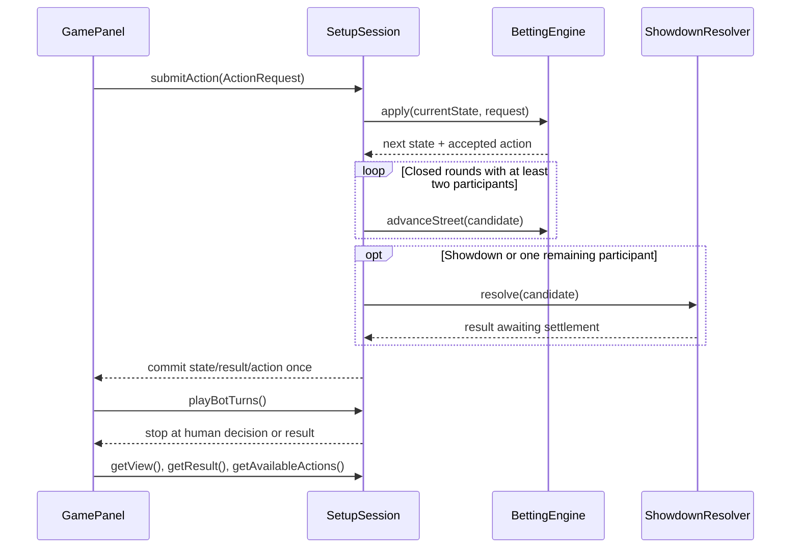

# Played-hand application flow

SetupSession extends the existing setup coordinator; it owns the only current
GameState. Swing receives SetupView snapshots, never the remaining deck or other
players' hole cards. The view includes the hand ID, phase, public board, stacks,
statuses and commitments. Its existing int actor accessor returns -1 when no
decision remains. All session calls run on the Swing event thread.

## Session contract

| API | Behavior |
| --- | --- |
| `start(humanCount)` | Initialize a separate hand, hide cards, clear history/result only after a successful start. It returns at the initial decision; the UI then calls playBotTurns. |
| `submitAction(request)` | Delegate legality/deductions to BettingEngine. Advance closed rounds, resolve a terminal comparison, then publish the candidate state and append exactly one accepted action. Any validation/comparison failure preserves the old state/result/log; private cards are hidden. |
| `playBotTurns()` | Temporary legal CHECK if available, otherwise CALL; stop before a human decision or after a result. Return an immutable list of newly committed bot actions. Does not inspect hole cards. |
| `getAvailableActions()` | Ask the pure engine about FOLD/CHECK/CALL using disposable snapshots; expose only supported legal actions. Queries never update the session/log/statistics. Empty before start or after a result. |
| `getResult()` | Optional immutable ShowdownResult. It is a comparison awaiting settlement, with no chip movement or completed-hand aggregation. |
| `getAcceptedActions()` | Immutable current-hand event snapshot, including human/bot actions and existing statistics context. No forced blind posts or invented runout actions; failed requests do not append. |

The coordinator keeps its candidate state local until advancement and comparison
succeed. A failed final comparison can therefore be retried without losing the
actor or counting the action twice. A result rejects further requests. Successful
restart creates a new hand/log; failed restart retains the old result/history.

## Transitions and privacy

BettingEngine owns betting/turn/street rules. The session requests advancement
only when decisions are closed. Multiple all-in participants can run out the
board without fake checks. A sole participant is resolved immediately without
dealing extra cards. The actor can still owe a response against an all-in
opponent, so one ACTIVE player alone is not a reason to skip that decision.

Accepted requests and rejected requests hide private cards. A human actor becomes
the selected viewer, with an explicit reveal still required. Starting the UI
executes initial bot turns and selects the next human. Selecting another human
disables action controls until the actor is selected again. Focus loss and locale
changes retain the existing concealment behavior. Selection is shared-computer
handoff, not authentication.

The screen displays public cards, phase, player status, chips, legal actions and
translated winner/tie/uncontested messages. It retains the selected language at
restart and can translate a pending result without replaying actions.

## Controlled demonstration and limits

With six 1,000-chip stacks, dealer 0 and blinds 10/20, use seat 3 CALL, seat 4 FOLD,
seat 5 CALL, seat 0 CALL, seat 1 CALL, seat 2 CHECK. Five participants reach the flop
with pot 100 and stacks 5,900. Check in order1/2/3/5/0 on each street. The final
check produces a real evaluator result awaiting settlement after 21 actions.
Tests use legal deterministic shuffle choices to produce both a shared-board
flush tie and a sole seat 5 six-high straight, without replacing game components.

Supported engine actions remain unraised preflop FOLD/CHECK/CALL and postflop
CHECK/FOLD. Bets/raises, raised-round responses, postflop CALL, pot/side-pot
payouts, repeated hands, equity bots and persistence remain later work. The
action log supports later PlayStats wiring; no pending hand is aggregated as
complete and no payout-dependent statistic is fabricated.

See [session BVA](../bva/SessionBetting.md) and
[bilingual Swing cases](../bva/PlayedGamePanel.md). Headless UI behavior and
offscreen layout checks do not establish native focus delivery or cross-platform
font correctness; those still require the team's desktop walkthrough.
